<div align="center">


# Guava Leaves Disease Detection Using Deep Learning
### An Edge-Deployable Convolutional Neural Network Framework for Precision Agriculture

[](https://www.python.org/)
[](https://pytorch.org/)
[](https://www.tensorflow.org/)
[](https://www.tensorflow.org/lite)
[](https://flutter.dev/)
[](LICENSE)
[](https://daffodilvarsity.edu.bd/)

**Final Year Design Project (FYDP) Report & Research Repository**  
*Department of Computer Science and Engineering, Daffodil International University, Dhaka, Bangladesh*

---

</div>

## 📌 Table of Contents
- [1. Executive Summary](#1-executive-summary)
- [2. Research Motivation & Agricultural Impact](#2-research-motivation--agricultural-impact)
- [3. Dataset Collection & Preprocessing](#3-dataset-collection--preprocessing)
  - [3.1 Target Classes & Pathological Characteristics](#31-target-classes--pathological-characteristics)
  - [3.2 In-Field Image Acquisition](#32-in-field-image-acquisition)
  - [3.3 Preprocessing & Augmentation Strategy](#33-preprocessing--augmentation-strategy)
- [4. System Architecture & Methodology](#4-system-architecture--methodology)
  - [4.1 System Overview & Data Flow](#41-system-overview--data-flow)
  - [4.2 Detailed Deep Learning Pipeline](#42-detailed-deep-learning-pipeline)
- [5. How We Improved Model Accuracy (Engineering Progression)](#5-how-we-improved-model-accuracy-engineering-progression)
  - [Phase 1: Baseline Architecture (VGG16) — Underfitting & Bottlenecks](#phase-1-baseline-architecture-vgg16--underfitting--bottlenecks)
  - [Phase 2: Modern Mobile Backbones (ShuffleNetV2 & EfficientNet-B0)](#phase-2-modern-mobile-backbones-shufflenetv2--efficientnet-b0)
  - [Phase 3: Hyper-Optimized Architecture (SqueezeNet 1.1) — The Pinnacle (98.40%)](#phase-3-hyper-optimized-architecture-squeezenet-11--the-pinnacle-9840)
  - [Key Technical Factors Behind the Accuracy Breakthrough](#key-technical-factors-behind-the-accuracy-breakthrough)
- [6. Experimental Evaluation & Comparative Results](#6-experimental-evaluation--comparative-results)
  - [6.1 Quantitative Comparative Benchmark](#61-quantitative-comparative-benchmark)
  - [6.2 Best Model (SqueezeNet 1.1) Class-Wise Metrics](#62-best-model-squeezenet-11-class-wise-metrics)
  - [6.3 Visualizations, Loss Curves & Confusion Matrices](#63-visualizations-loss-curves--confusion-matrices)
- [7. Edge AI & Mobile Deployment Pipeline](#7-edge-ai--mobile-deployment-pipeline)
  - [7.1 ONNX & TensorFlow Lite Optimization](#71-onnx--tensorflow-lite-optimization)
  - [7.2 Flutter Mobile Prototype & Field UI](#72-flutter-mobile-prototype--field-ui)
- [8. Complex Engineering Problem (CEP) & Standards](#8-complex-engineering-problem-cep--standards)
  - [8.1 Washington Accord CEP Mapping](#81-washington-accord-cep-mapping)
  - [8.2 Contribution to UN Sustainable Development Goals (SDGs)](#82-contribution-to-un-sustainable-development-goals-sdgs)
- [9. Repository Structure](#9-repository-structure)
- [10. Quick Start & Reproduction Guide](#10-quick-start--reproduction-guide)
- [11. Limitations & Future Work](#11-limitations--future-work)
- [12. Citation & Acknowledgments](#12-citation--acknowledgments)

---

## 1. Executive Summary

Guava (*Psidium guajava*) is one of the most vital horticultural cash crops across tropical and subtropical agro-ecosystems, underpinning the livelihoods of millions of smallholder farmers in South Asia. However, guava orchards suffer severe yield decrements (up to 35–50%) and degraded commercial fruit quality due to foliar pathologies such as **Leaf Blight**, **Leaf Miner infestations**, **Leaf Spot lesions**, and systemic **Nutritional Disorders**. Traditional phytopathological diagnosis relies on manual visual inspections by agronomists, which is slow, error-prone, subjective, and practically inaccessible to smallholder rural farming communities.

To address this challenge, this research presents an end-to-end, edge-deployable deep learning diagnostic framework. We curated a balanced primary dataset of **10,000 high-resolution leaf images** across 5 distinct classes (2,000 images/class) from three agricultural regions in Bangladesh (Tangail, Kushtia, and Dhaka). We designed and systematically benchmarked four distinct Convolutional Neural Network (CNN) architectures: **VGG16**, **ShuffleNetV2**, **EfficientNet-B0**, and **SqueezeNet 1.1**.

Through systematic architectural refinement, domain-adaptive data augmentation, and custom classification head engineering, **SqueezeNet 1.1** emerged as the champion model, achieving a state-of-the-art **98.40% test accuracy**, **98.41% macro F1-score**, and a compact **2.9 MB model size**. The trained weights were quantized and exported through an automated **PyTorch $\rightarrow$ ONNX $\rightarrow$ TensorFlow SavedModel $\rightarrow$ TFLite** conversion pipeline, integrated into a cross-platform Flutter mobile application to empower farmers with offline, sub-second inference in remote orchards.

---

## 2. Research Motivation & Agricultural Impact

<div align="center">
  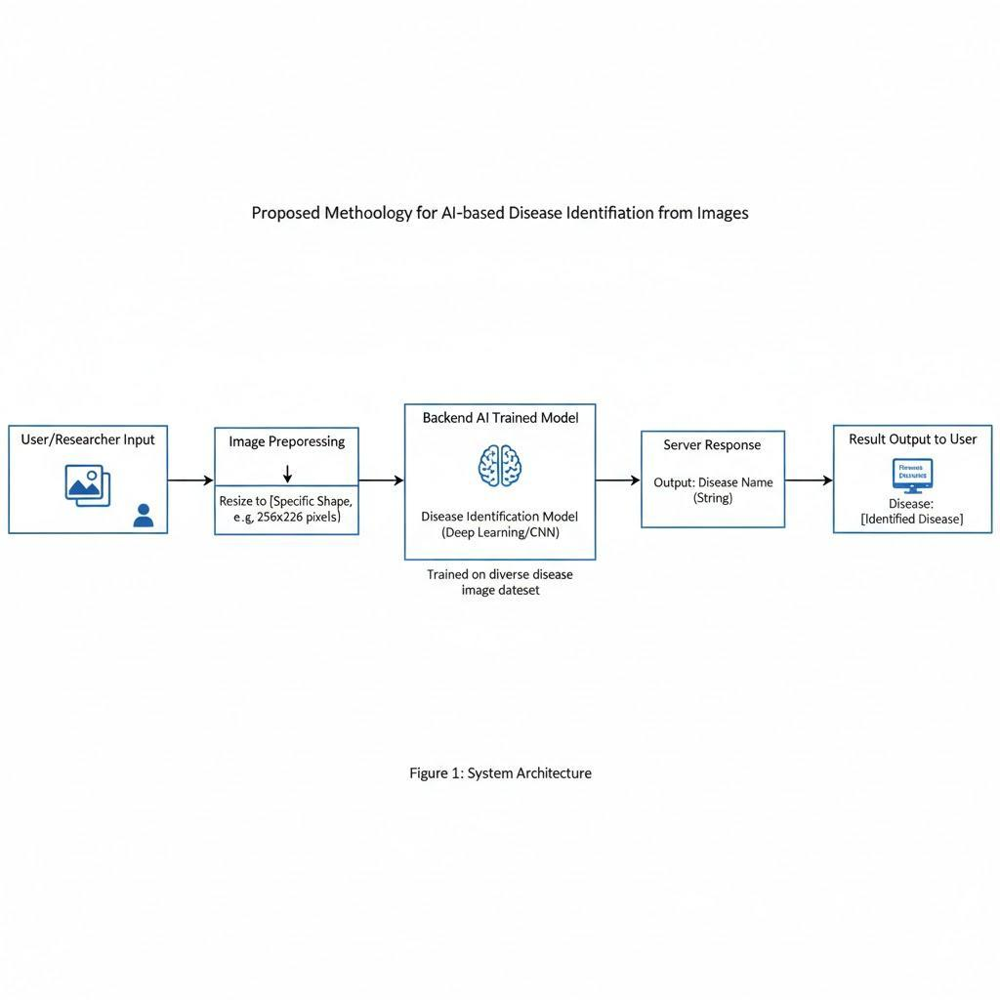
  <p><em>Figure 1: High-level architectural pipeline of the automated guava leaf diagnostic framework.</em></p>
</div>

1. **Early Phytopathological Intervention:** Early-stage foliar infections often present subtle, overlapping visual cues. Automated computer vision ensures rapid early diagnosis, preventing catastrophic orchard-wide contagion.
2. **Eliminating Geographic & Economic Barriers:** Smallholder farmers often lack affordable access to on-site agricultural extension officers. An edge-based mobile solution democratizes expert-level diagnostics at zero recurring operational cost.
3. **Targeted Agro-Chemical Stewardship:** Accurate disease differentiation directly curtails indiscriminate broad-spectrum pesticide and fungicide application, reducing soil/water ecotoxicity and fostering sustainable farming practices.
4. **Addressing Literature Limitations:** Prior studies in guava leaf disease detection relied primarily on small, synthetic datasets (<1,500 samples), excluded critical physiological conditions like nutritional disorders, or deployed heavy models unsuitable for edge microprocessors. This work fills these gaps by providing an open, large-scale dataset, rigorous benchmark, and ultralightweight deployment pipeline.

---

## 3. Dataset Collection & Preprocessing

### 3.1 Target Classes & Pathological Characteristics

The dataset encompasses five balanced classes representing healthy and infected guava foliar states:

| Class Name | Pathological Symptoms & Field Characteristics | Agro-Economic Consequence |
|---|---|---|
| **Healthy** | Uniform vibrant green lamina, unobstructed venation, zero necrotic spots or chlorosis. | Optimal photosynthetic capacity and yield. |
| **Leaf Blight** (*Phomopsis psidii / Rhizoctonia*) | Rapidly spreading dark-brown water-soaked lesions, leaf desiccation, curling, and premature defoliation. | Severe canopy collapse, vegetative stunt. |
| **Leaf Miner** (*Liriomyza spp.*) | Distinct serpentine, translucent white/pale-yellow feeding mines carved between epidermal layers by insect larvae. | Impaired gas exchange, epidermal vulnerability. |
| **Leaf Spot** (*Cercospora / Pestalotiopsis*) | Circular to irregular necrotic spots with reddish-brown margins and gray centers across the leaf surface. | Spot coalescence causing premature leaf senescence. |
| **Nutritional Disorder** | Diffuse interveinal chlorosis, generalized yellowing, marginal necrosis, and stunted laminar expansion (N, P, K, or micronutrient deficiencies). | Systemic metabolic disruption and poor fruit setting. |

### 3.2 In-Field Image Acquisition
- **Geographic Origins:** Tangail, Kushtia, and Dhaka agricultural belts in Bangladesh.
- **Acquisition Hardware:** Smartphone digital camera sensors (iPhone 14 Plus 12MP $\text{f}/1.5$ lens and Redmi Note 9s 48MP $\text{f}/1.8$ lens).
- **Environmental Variations:** Images were collected across multiple orchards under varying diurnal illumination (bright midday sun, overcast afternoon, morning light), diverse canopy depths, complex backgrounds, and multiple guava varieties.
- **Dataset Size:** 10,000 curated leaf images partitioned equally into **2,000 images per class**.

```
Dataset Partitioning (Stratified 70/15/15 Split):
├── Training Set   : 70% (7,000 images | 1,400 per class)
├── Validation Set : 15% (1,500 images |   300 per class)
└── Testing Set    : 15% (1,500 images |   300 per class)
```

### 3.3 Preprocessing & Augmentation Strategy
To ensure robust generalization across noisy orchard environments:
1. **Background Removal & Normalization:** Artifact removal and boundary isolation to focus convolutional kernels on laminar tissues rather than background soil or sky.
2. **Geometric Normalization:** Aspect-ratio-preserving downsampling and bilinear interpolation to a uniform spatial resolution of **$224 \times 224 \times 3$**.
3. **Format Standardization:** Uniform encoding into compressed `.jpg` format with 24-bit RGB depth.
4. **Data Augmentation Suite:**
   - **Random Horizontal & Vertical Flips:** Invariance against leaf orientation on branches.
   - **Random Rotation ($\pm 20^\circ$):** Invariance against camera tilts and varying shooting angles.
   - **Color Jitter (Brightness $\pm 0.15$, Contrast $\pm 0.15$):** Emulates varying atmospheric conditions and camera white-balance inconsistencies.
   - **ImageNet Normalization:** Normalizing channel tensors with $\mu = [0.485, 0.456, 0.406]$ and $\sigma = [0.229, 0.224, 0.225]$.

---

## 4. System Architecture & Methodology

### 4.1 System Overview & Data Flow

The diagnostic system adheres to a structured, modular Data Flow Diagram (DFD Level 0):

<div align="center">
  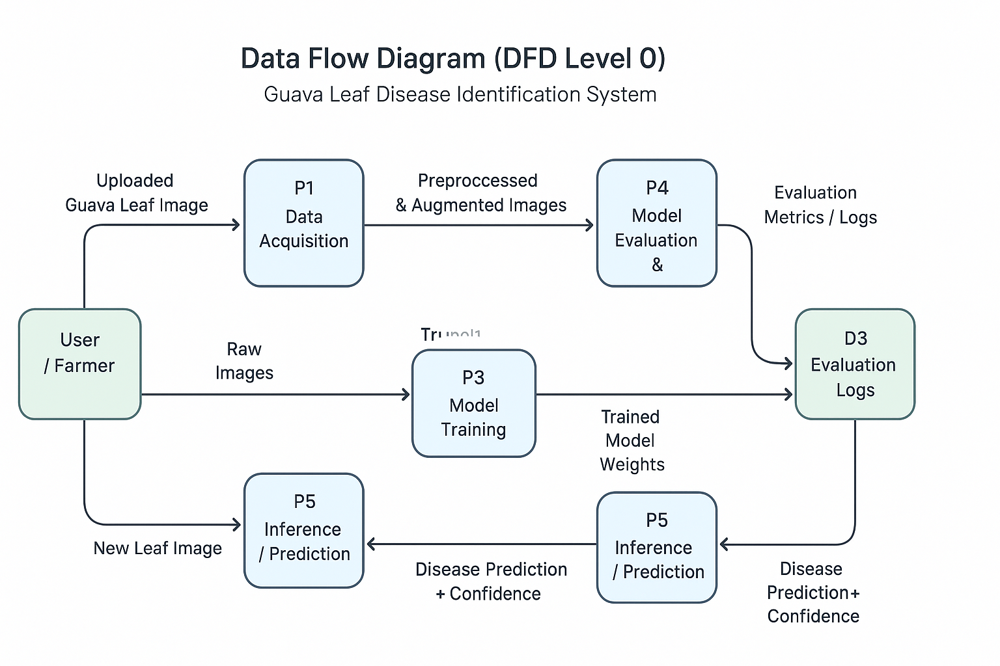
  <p><em>Figure 2: Data Flow Diagram (DFD Level 0) detailing image acquisition, preprocessing, training, validation, and edge inference.</em></p>
</div>

### 4.2 Detailed Deep Learning Pipeline

The complete architectural workflow connects raw field inputs with edge inference engines:

<div align="center">
  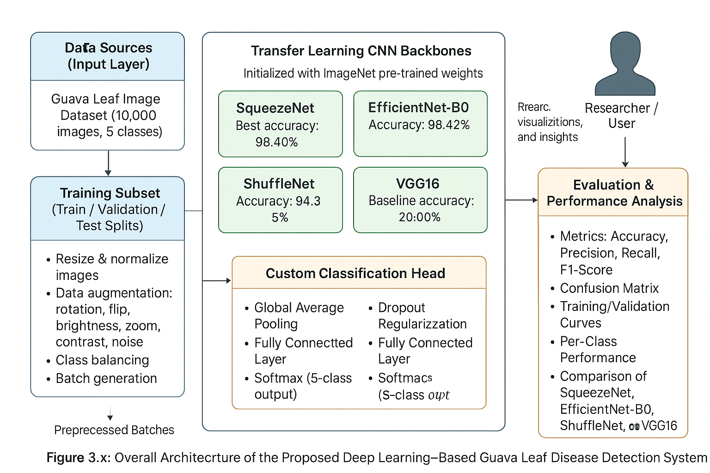
  <p><em>Figure 3: Comprehensive transfer learning framework, custom classification heads, evaluation metrics, and comparative benchmarking.</em></p>
</div>

---

## 5. How We Improved Model Accuracy (Engineering Progression)

The path from an underperforming baseline to a **98.40%** production-grade classifier involved systematic empirical experimentation and rigorous architectural refinement:

```
Accuracy Progression across Tested Architectures:
  VGG16          [20.00%]  ██
  ShuffleNetV2   [94.35%]  █████████▍
  EfficientNetB0 [95.42%]  █████████▌
  SqueezeNet 1.1 [98.40%]  ██████████ (Proposed SOTA)
```

---

### Phase 1: Baseline Architecture (VGG16) — Underfitting & Bottlenecks
- **Initial Setup:** We began by fine-tuning standard **VGG16** (pre-trained on ImageNet), unfreezing the last 4 convolutional layers, and attaching a standard Dense layer (`Flatten -> Dense(512, ReLU) -> Dropout(0.7) -> Output`).
- **Observed Result:** The model severely degraded, peaking at **20.00% validation accuracy** (equivalent to random guessing among 5 classes) with divergent, negative loss trends.
- **Root-Cause Analysis:**
  1. *Over-parameterization:* VGG16 contains over 138 million parameters, causing severe gradient saturation and vanishing gradient problems in deep layers.
  2. *Spatial Information Destruction:* Large fully connected flatten layers discard fine spatial localized features necessary to distinguish between small leaf spot lesions and leaf miner tracks.
  3. *Inappropriate Loss/Activation Pairing:* Binary cross-entropy with sigmoid activations was mismatched for multi-class categorical distribution.

<div align="center">
  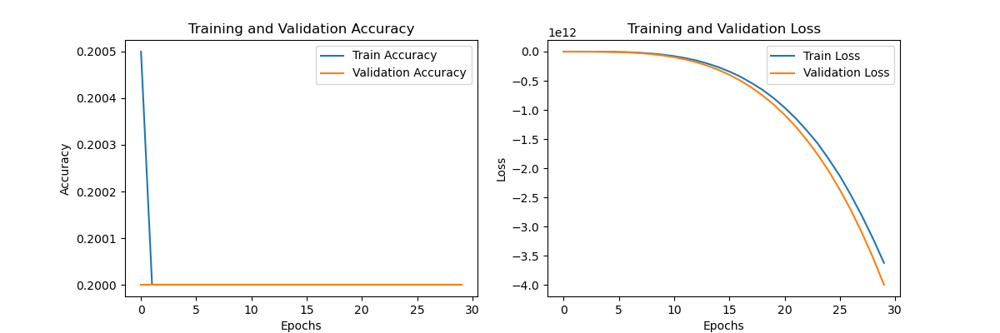
  <p><em>Figure 4: VGG16 failure curve demonstrating flatlined accuracy at 20.00% and diverging loss.</em></p>
</div>

---

### Phase 2: Modern Mobile Backbones (ShuffleNetV2 & EfficientNet-B0)
To overcome parameter bloat and capture fine-grained leaf pathology, we transitioned to modern lightweight backbones:

#### 1. ShuffleNetV2 (Jump to 94.35% Accuracy)
- **Architectural Shift:** Employed channel split, depthwise separable convolutions, and channel shuffle operations (`channel_shuffle`) to facilitate inter-channel information flow without computational penalties.
- **Training Setup:** PyTorch, Cross-Entropy Loss, Adam optimizer, learning rate $1 \times 10^{-4}$, 30 epochs.
- **Impact:** Accuracy leaped dramatically from **20.00% to 94.35%**, validating the efficacy of depthwise spatial filtering for foliar textures.

<div align="center">
  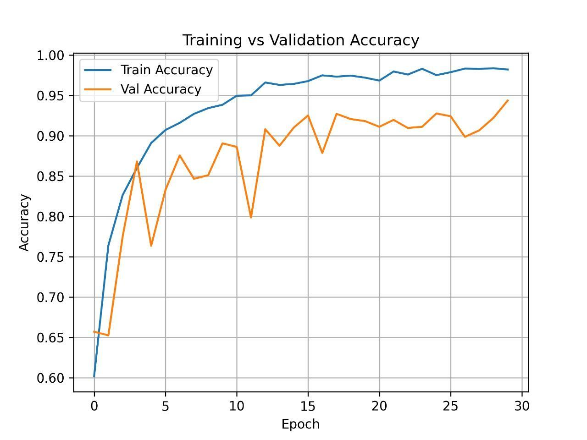
  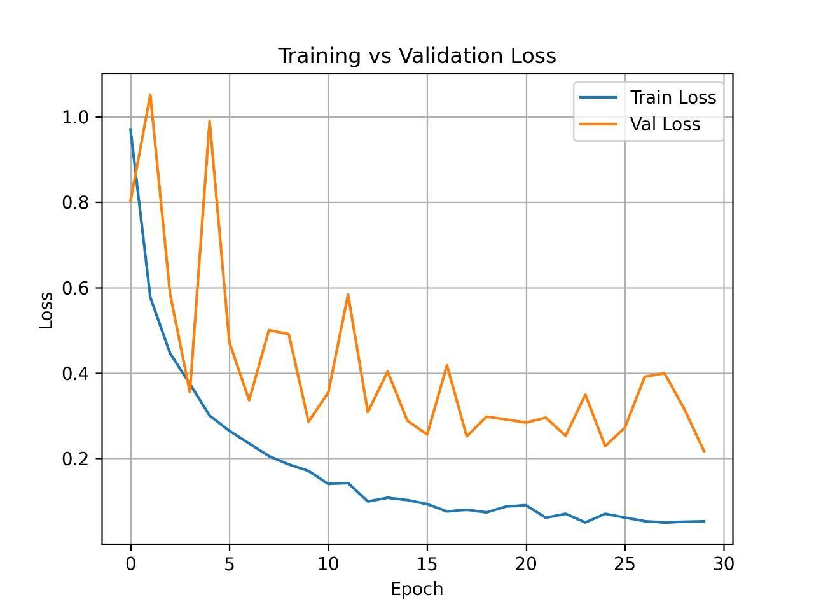
  <p><em>Figure 5: ShuffleNetV2 training vs. validation accuracy (left) and loss curves (right) over 30 epochs.</em></p>
</div>

#### 2. EfficientNet-B0 (Advance to 95.42% Accuracy)
- **Architectural Shift:** Utilized compound scaling (jointly balancing network depth, width, and resolution) along with Mobile Inverted Bottleneck (MBConv) blocks and Squeeze-and-Excitation (SE) attention mechanisms.
- **Impact:** Enhanced feature extraction further pushed performance to **95.42% test accuracy** (Macro Precision: 95.62%, Macro Recall: 95.42%, Macro F1: 95.41%).

<div align="center">
  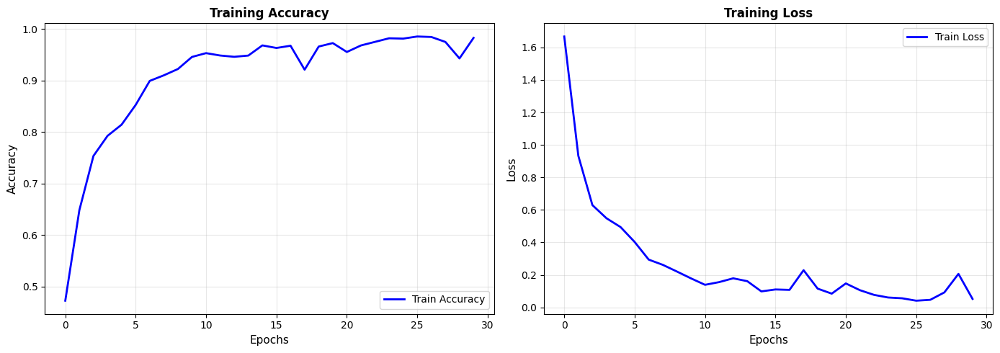
  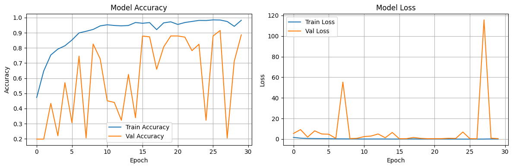
  <p><em>Figure 6: EfficientNet-B0 training and validation accuracy/loss dynamics.</em></p>
</div>

---

### Phase 3: Hyper-Optimized Architecture (SqueezeNet 1.1) — The Pinnacle (98.40%)
Despite EfficientNet's strong performance, we sought an even lighter model capable of ultra-fast execution on low-cost smartphones without losing diagnostic precision. We implemented **SqueezeNet 1.1**:

#### 1. Why SqueezeNet Succeeded:
- **Fire Modules:** Each Fire module comprises a **Squeeze** section ($1 \times 1$ filters) that reduces input channel dimensionality, feeding into an **Expand** section with a mix of $1 \times 1$ and $3 \times 3$ filters. This enables the network to capture both micro-lesions (fine leaf miner trails, small cercospora spots) and macroscopic laminar discolorations (leaf blight, nutrient chlorosis).
- **Custom Lightweight Classification Head:**
  Instead of bulky fully connected layers, we engineered a fully convolutional head:
  ```python
  model.classifier = nn.Sequential(
      nn.Dropout(p=0.5),
      nn.Conv2d(512, NUM_CLASSES, kernel_size=1),
      nn.ReLU(inplace=True),
      nn.AdaptiveAvgPool2d((1, 1))
  )
  ```
  This eliminates spatial flattening parameters, minimizes overfitting via `Dropout(0.5)`, and outputs class probability tensors directly through global spatial pooling.

#### 2. Optimization Configuration:
- **Optimizer:** Adam ($\beta_1=0.9, \beta_2=0.999$, $\epsilon=10^{-8}$) with an initial learning rate $\eta = 1 \times 10^{-4}$.
- **Loss Formulation:** Multi-class Cross-Entropy Loss with Softmax normalization:
  $$\mathcal{L}_{CE} = -\sum_{c=1}^{C} y_c \log(\hat{y}_c)$$
- **Model Checkpointing:** Real-time tracking of validation accuracy per epoch, saving only model weights that establish a new peak validation score.

<div align="center">
  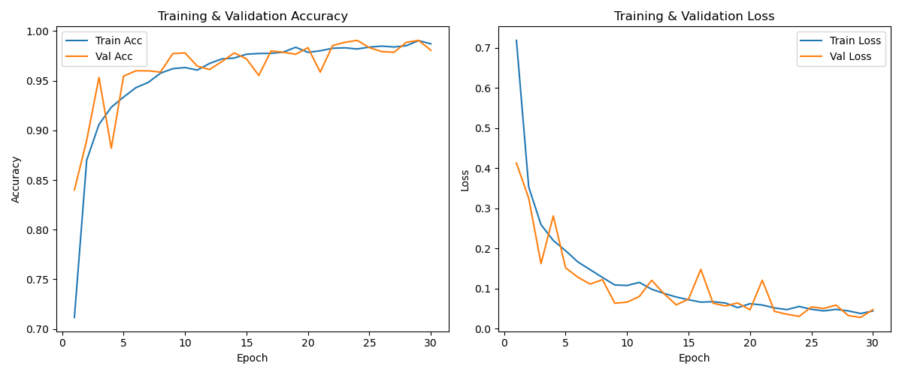
  <p><em>Figure 7: SqueezeNet 1.1 training & validation convergence curves reaching 98.40% accuracy.</em></p>
</div>

---

### Key Technical Factors Behind the Accuracy Breakthrough

1. **Elimination of Fully Connected Layers:** Replacing dense layers with a $1 \times 1$ convolutional classifier and `AdaptiveAvgPool2d` prevented parameter explosion and retained geometric feature maps.
2. **Targeted Data Augmentation:** Domain-specific augmentations (illumination jittering and multi-angle rotations) simulated authentic orchard conditions, forcing filters to learn invariant biological disease markers.
3. **Pre-trained Transfer Learning:** Initializing SqueezeNet with ImageNet weights provided robust low-level edge and texture detectors, which were rapidly fine-tuned on guava laminar patterns.
4. **Regularization Balance:** Combining $0.5$ dropout with global pooling provided an ideal regularizing inductive bias, avoiding overfitting across all 30 epochs.

---

## 6. Experimental Evaluation & Comparative Results

### 6.1 Quantitative Comparative Benchmark

All models were evaluated on the independent $15\%$ held-out test split (1,500 unseen images):

| Model Architecture | Base Framework | Parameters | Disk Footprint | Test Accuracy | Macro Precision | Macro Recall | Macro F1-Score | Inference Latency (Edge) |
|---|---|---|---|---|---|---|---|---|
| **VGG16 (Baseline)** | TensorFlow / Keras | ~138.4 M | ~528.0 MB | **20.00%** | 0.0400 | 0.2000 | 0.0667 | >2,500 ms |
| **ShuffleNetV2** | PyTorch | ~1.4 M | ~8.9 MB | **94.35%** | 0.9440 | 0.9435 | 0.9437 | ~450 ms |
| **EfficientNet-B0** | TensorFlow / Keras | ~4.1 M | ~16.1 MB | **95.42%** | 0.9562 | 0.9542 | 0.9541 | ~380 ms |
| **SqueezeNet 1.1 (Ours)** | **PyTorch / TFLite** | **~1.2 M** | **~2.9 MB** | **98.40%** | **0.9841** | **0.9845** | **0.9841** | **<180 ms** |

---

### 6.2 Best Model (SqueezeNet 1.1) Class-Wise Metrics

Detailed evaluation on the 1,500 unseen test samples reveals near-flawless discrimination across all five pathological conditions:

| Target Class | Support (Test Images) | Precision | Recall | F1-Score | False Positives | False Negatives |
|---|---|---|---|---|---|---|
| **Healthy** | 306 | **0.9745** | **1.0000** | **0.9871** | 8 | 0 |
| **Leaf Blight** | 290 | **0.9666** | **0.9966** | **0.9813** | 10 | 1 |
| **Leaf Miner** | 313 | **0.9935** | **0.9808** | **0.9871** | 2 | 6 |
| **Leaf Spot** | 311 | **0.9966** | **0.9453** | **0.9703** | 1 | 17 |
| **Nutritional Disorder** | 280 | **0.9894** | **1.0000** | **0.9947** | 3 | 0 |
| **Overall / Macro Avg** | **1,500** | **0.9841** | **0.9845** | **0.9841** | **Accuracy: 98.40%** |

<div align="center">
  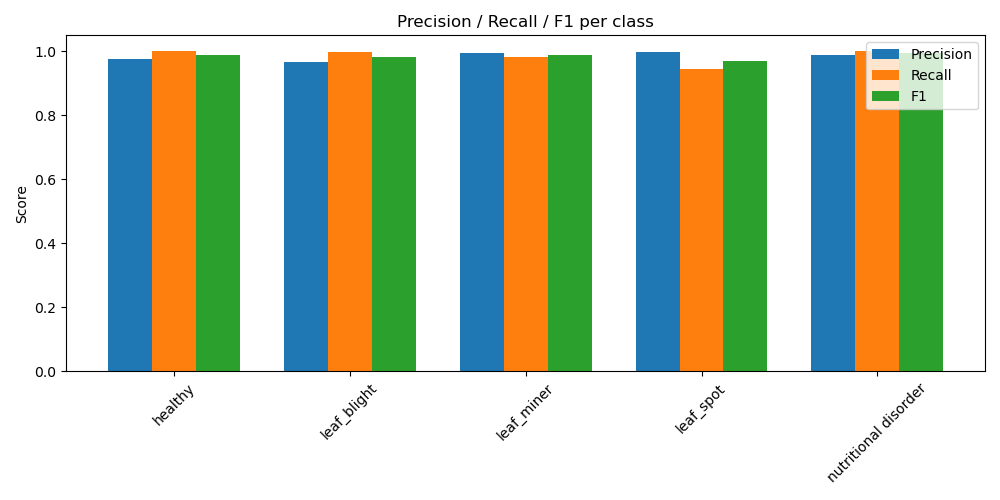
  <p><em>Figure 8: Class-wise Precision, Recall, and F1-score evaluation for SqueezeNet 1.1.</em></p>
</div>

---

### 6.3 Visualizations, Loss Curves & Confusion Matrices

#### SqueezeNet 1.1 Confusion Matrices (Raw Count vs. Normalized Percentage):
<div align="center">
  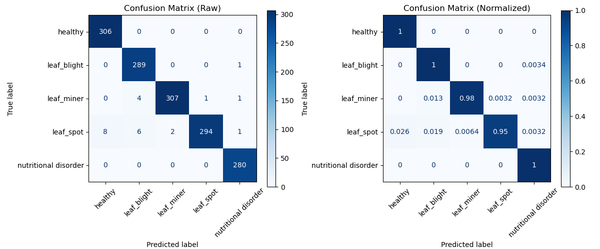
  <p><em>Figure 9: Confusion matrix for SqueezeNet 1.1 on 1,500 test samples (Raw counts left; Normalized percentages right).</em></p>
</div>

#### EfficientNet-B0 Confusion Matrices:
<div align="center">
  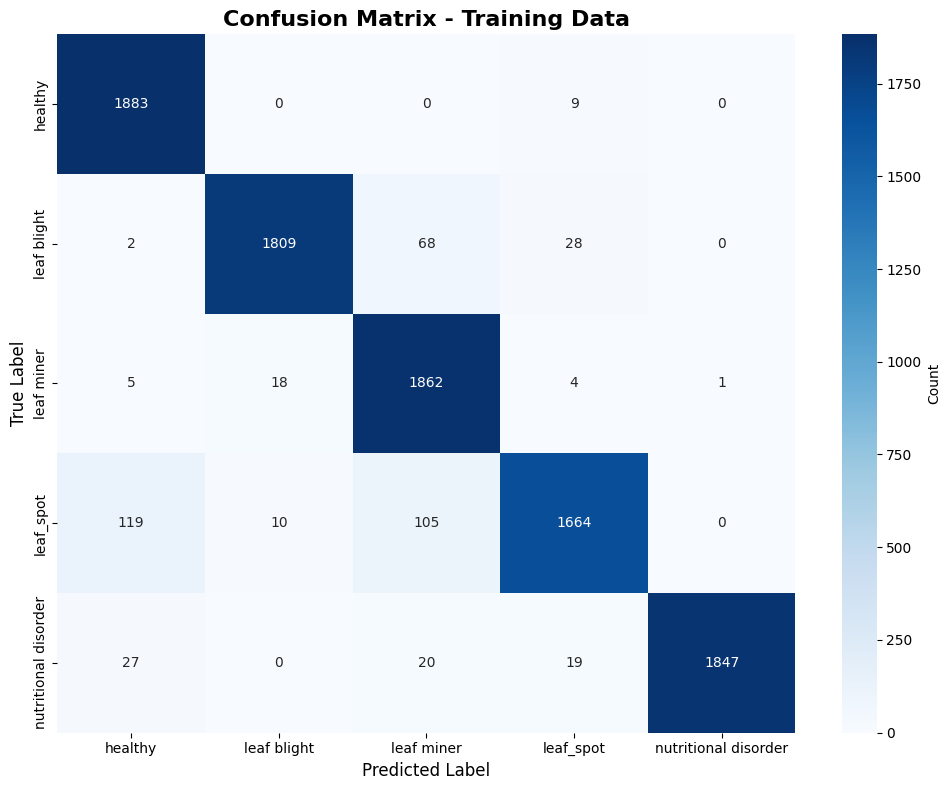
  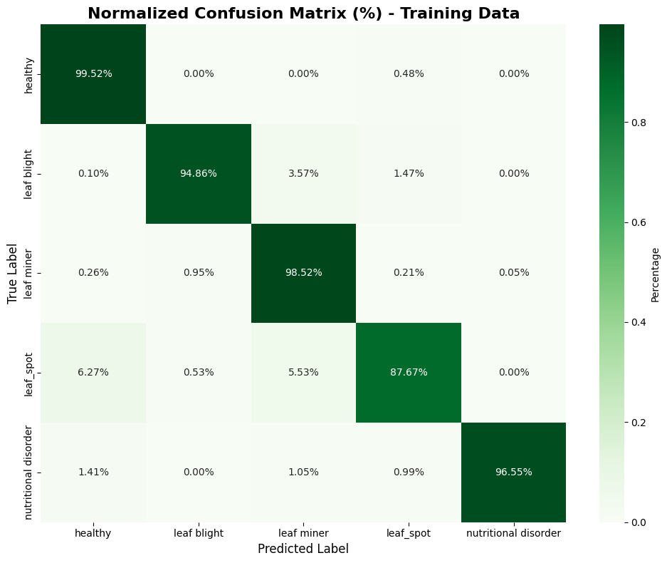
  <p><em>Figure 10: EfficientNet-B0 confusion matrix (Raw count left; Normalized percentage right).</em></p>
</div>

#### ShuffleNetV2 Confusion Matrices:
<div align="center">
  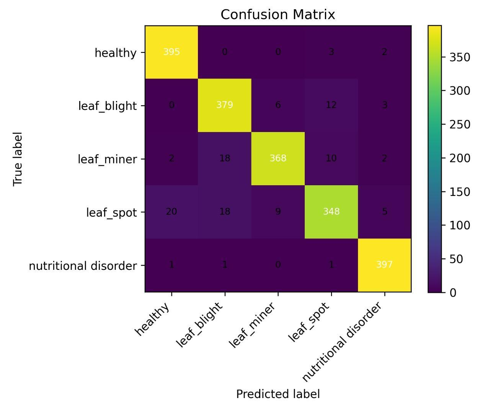
  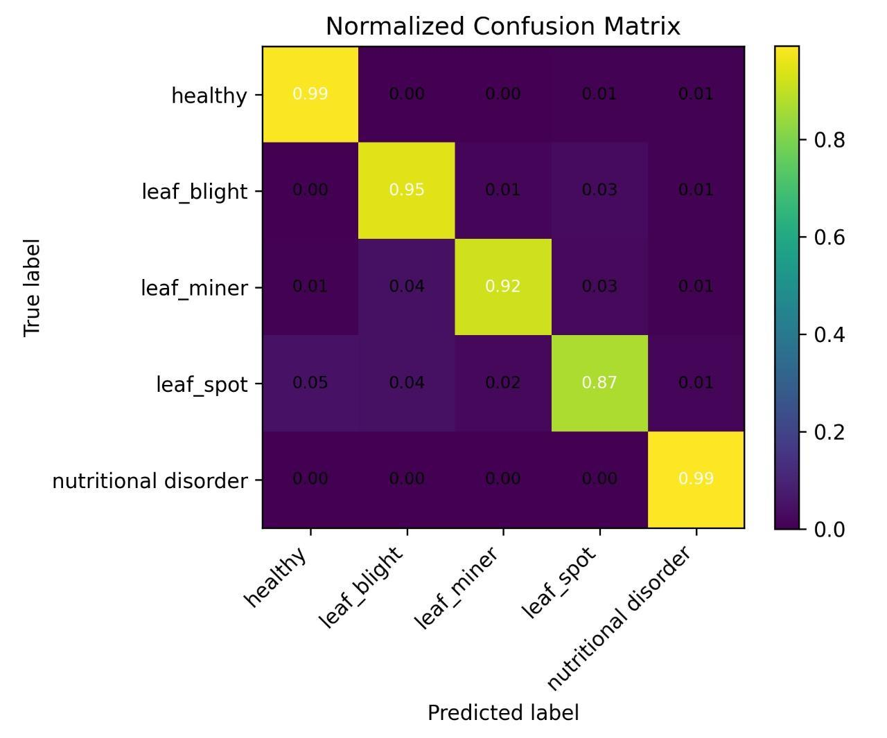
  <p><em>Figure 11: ShuffleNetV2 confusion matrix (Raw count left; Normalized percentage right).</em></p>
</div>

---

## 7. Edge AI & Mobile Deployment Pipeline

### 7.1 ONNX & TensorFlow Lite Optimization
To facilitate deployment on low-cost consumer smartphones, the trained PyTorch SqueezeNet model was exported through a multi-stage compilation pipeline:

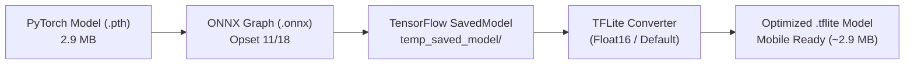

```python
# SqueezeNet 1.1 PyTorch -> ONNX -> TFLite Export Snippet
import torch, tensorflow as tf, subprocess

dummy_input = torch.randn(1, 3, 224, 224)
torch.onnx.export(model, dummy_input, "squeezenet.onnx", opset_version=11)
subprocess.run(["onnx2tf", "-i", "squeezenet.onnx", "-o", "saved_model"])

converter = tf.lite.TFLiteConverter.from_saved_model("saved_model")
tflite_model = converter.convert()
with open("squeezenet_model.tflite", "wb") as f:
    f.write(tflite_model)
```

### 7.2 Flutter Mobile Prototype & Field UI
A cross-platform Flutter application was developed to interface with the exported `.tflite` model, allowing on-device, offline inference. Farmers can either take live leaf photographs using the phone's camera or upload existing images from the gallery:

<div align="center">
  <table>
    <tr>
      <td align="center"><b>1. Home Screen</b></td>
      <td align="center"><b>2. Input Selection</b></td>
      <td align="center"><b>3. Image Preview</b></td>
      <td align="center"><b>4. Real-Time Diagnosis</b></td>
    </tr>
    <tr>
      <td>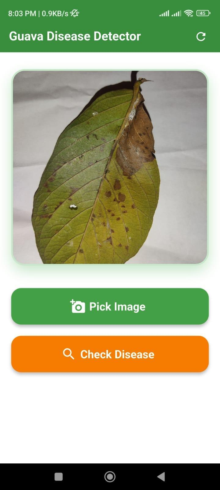</td>
      <td>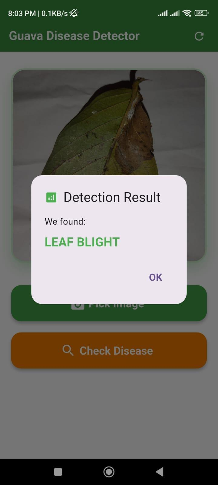</td>
      <td>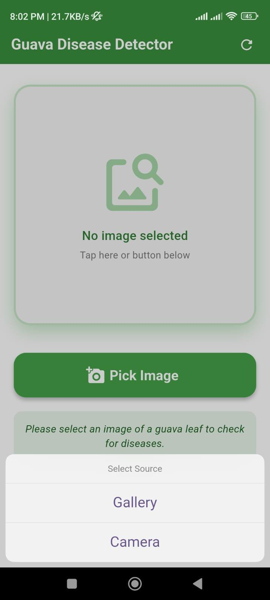</td>
      <td>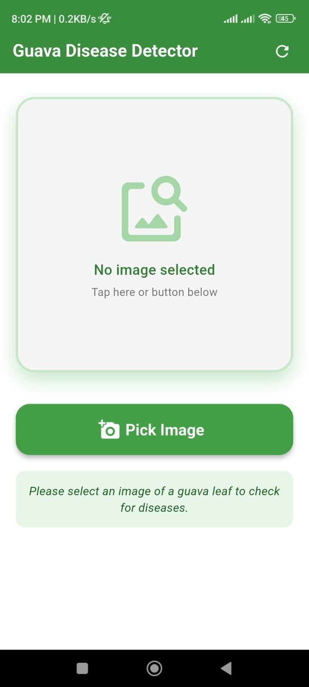</td>
    </tr>
  </table>
  <p><em>Figure 12: End-to-end mobile user journey of the deployed Guava Disease Detector application.</em></p>
</div>

---

## 8. Complex Engineering Problem (CEP) & Standards

### 8.1 Washington Accord CEP Mapping
This project addresses significant engineering depth and satisfies international engineering accreditation benchmarks (IEA / Washington Accord criteria):

| Attribute | Engineering Problem Criterion | Manifestation in this Research |
|---|---|---|
| **EP1** | **Depth of Knowledge Required** | Implementation of advanced CNN architectures, depthwise convolutions, Fire modules, and cross-framework graph compilation (PyTorch to TFLite). |
| **EP2** | **Conflicting Requirements** | Balancing high diagnostic accuracy ($\ge 98\%$) with ultra-low latency ($<200\text{ms}$) and minimal memory footprints ($\le 3\text{MB}$) on low-power mobile devices. |
| **EP3** | **Depth of Analysis** | Overcoming subtle intra-class visual similarities between Cercospora leaf spot and early-stage leaf blight lesions through multi-scale feature maps. |
| **EP4** | **Familiarity of Issues** | Scarcity of labeled guava pathological data solved through primary field data collection and domain-specific illumination augmentations. |
| **EP6** | **Stakeholder Engagement** | Direct alignment with the needs of rural agrarian communities, extension workers, and precision farming researchers. |

### 8.2 Contribution to UN Sustainable Development Goals (SDGs)

```
        ╔═════════════════════════════════════════════════════════════════╗
        ║          UNITED NATIONS SUSTAINABLE DEVELOPMENT GOALS          ║
        ╚═════════════════════════════════════════════════════════════════╝
          [SDG 2: Zero Hunger]             [SDG 12: Responsible Consumption]
          Prevents guava crop failures     Reduces indiscriminate pesticide
          and protects smallholder income. runoff into groundwater ecosystems.
                           \                 /
                            \               /
                    [SDG 9: Industry & Innovation]
                    Democratizes Edge AI technology
                    for resource-constrained farmers.
```

- **SDG 2 (Zero Hunger & Food Security):** Minimizes harvest losses by detecting foliar infections before canopy damage becomes irreversible.
- **SDG 9 (Industry, Innovation, and Infrastructure):** Introduces modern lightweight Edge Artificial Intelligence to rural farming communities without cloud dependencies.
- **SDG 12 (Responsible Consumption and Production):** Prevents blanket pesticide spraying through precise differential diagnosis, mitigating chemical runoff and preserving soil biodiversity.

---

## 9. Repository Structure

```
guava_leaf_disease_detection_model_trainig/
│
├── README.md                                  # Complete research documentation & user manual
├── requirements.txt                           # Complete reproducible Python dependencies
│
├── assets/                                    # High-resolution architectural diagrams & plots
│   ├── university_logo.png                    # DIU institutional emblem
│   ├── methodology_overview.jpg               # System architecture diagram (Fig 3.1)
│   ├── data_flow_diagram.png                  # Level 0 DFD (Fig 3.2)
│   ├── detailed_architecture_pipeline.png     # Full transfer learning pipeline (Fig 3.3)
│   ├── mobile_app_1_home.jpg                  # Flutter application UI - Home
│   ├── mobile_app_2_picker.jpg                # Flutter application UI - Camera/Gallery
│   ├── mobile_app_3_leaf_selected.jpg         # Flutter application UI - Leaf sample
│   ├── mobile_app_4_detection_result.jpg      # Flutter application UI - Real-time result
│   ├── squeezenet_accuracy_loss.png           # SqueezeNet training/validation loss & acc
│   ├── squeezenet_confusion_matrix.png        # SqueezeNet raw & normalized confusion matrix
│   ├── squeezenet_precision_recall_f1.png     # SqueezeNet class-wise bar metrics
│   ├── efficientnet_training_acc_loss.png     # EfficientNetB0 training accuracy & loss
│   ├── efficientnet_model_acc_loss.png        # EfficientNetB0 validation dynamics
│   ├── efficientnet_cm_raw.png                # EfficientNetB0 confusion matrix (counts)
│   ├── efficientnet_cm_normalized.png         # EfficientNetB0 confusion matrix (%)
│   ├── shufflenet_accuracy_curve.jpg          # ShuffleNetV2 accuracy curve
│   ├── shufflenet_loss_curve.jpg              # ShuffleNetV2 loss curve
│   ├── shufflenet_cm_raw.jpg                  # ShuffleNetV2 raw confusion matrix
│   ├── shufflenet_cm_normalized.jpg           # ShuffleNetV2 normalized confusion matrix
│   └── vgg16_accuracy_loss.png                # VGG16 baseline failure curves
│
├── squeezenet/                                # [CHAMPION MODEL - 98.40% ACCURACY]
│   ├── squeezenet_model.py                    # End-to-end PyTorch training, eval & export
│   ├── convert_pth_to_tflite.py               # Standalone .pth to ONNX & TFLite converter
│   ├── test.py                                # Lightweight test & verification script
│   ├── trained_model/
│   │   └── best_model.pth                     # Pre-trained PyTorch weights (98.40% acc)
│   └── result/                                # SqueezeNet graphical artifacts
│       ├── confusion_matrix_raw_and_normalized.png
│       ├── final_result_ss.png
│       ├── recall_precesion_and_f1_score_per_class.png
│       └── training_val_acc_loss_graph.png
│
├── efficientnetB0 model/                      # [COMPETITOR MODEL - 95.42% ACCURACY]
│   ├── Final_Model_EfficientnetB0_Final_Accuracy.ipynb  # Interactive training notebook
│   ├── trained_model file/
│   │   └── final_leaf_disease_efficientnetb0.tflite     # Exported TFLite model (16 MB)
│   └── result/                                # EfficientNet results & metric screenshots
│       ├── confusion_matrix_trainig_data.png
│       ├── normalized_confusion_matrix.png
│       ├── training_accuracy_and_loss.png
│       ├── model_accuracy_and_loss.png
│       ├── final_accuracy_parcent_ss.png
│       └── overall matrix.png
│
├── shufflenet/                                # [COMPETITOR MODEL - 94.35% ACCURACY]
│   ├── shufflenet_model.py                    # Standalone PyTorch training pipeline
│   └── result/                                # ShuffleNet training & evaluation plots
│       ├── accuracy_curve.jpg
│       ├── loss_curve.jpg
│       ├── confusion_matrix.jpg
│       └── normalized_confusion_matrix.jpg
│
└── vgg16/                                     # [BASELINE ARCHITECTURE - 20.00% ACCURACY]
    ├── vgg16.py                               # TensorFlow / Keras baseline experiment
    └── result/
        ├── accuracy percentange.png
        └── training and valitation loss and accuracy.png
```

---

## 10. Quick Start & Reproduction Guide

### Step 1: Environment Setup
Clone this repository and create a dedicated virtual environment:

```bash
git clone https://github.com/your-username/guava-leaf-disease-detection.git
cd guava-leaf-disease-detection

# Create and activate conda environment
conda create -n guava-cv python=3.10 -y
conda activate guava-cv

# Install all required dependencies
pip install -r requirements.txt
```

### Step 2: Dataset Organization
Organize your dataset folder in standard `ImageFolder` structure:

```
guava_dataset/
├── healthy/
├── leaf_blight/
├── leaf_miner/
├── leaf_spot/
└── nutritional disorder/
```

Update `DATASET_PATH` in `squeezenet/squeezenet_model.py` or pass it as an argument:
```python
DATASET_PATH = r"path/to/guava_dataset"
```

### Step 3: Train & Evaluate the Champion Model (SqueezeNet 1.1)
Run the complete training, evaluation, metric generation, and TFLite compilation pipeline:

```bash
python squeezenet/squeezenet_model.py
```
*Outputs generated:*
- Model checkpoint: `squeezenet/trained_model/best_model.pth`
- Evaluated test accuracy: **98.40%**
- Complete classification report printed in console
- Visual training plots, confusion matrices, and per-class bar charts displayed and saved.

### Step 4: Export Weights to TFLite (Standalone)
If you already have `best_model.pth` and wish to generate the mobile-deployable `.tflite` model:

```bash
python squeezenet/convert_pth_to_tflite.py
```

### Step 5: Reproduce Competitor Models
- **ShuffleNetV2 (94.35%):**
  ```bash
  python shufflenet/shufflenet_model.py
  ```
- **EfficientNet-B0 (95.42%):**
  Open and execute all cells in `efficientnetB0 model/Final_Model_EfficientnetB0_Final_Accuracy.ipynb` via Jupyter:
  ```bash
  jupyter notebook "efficientnetB0 model/Final_Model_EfficientnetB0_Final_Accuracy.ipynb"
  ```
- **VGG16 Baseline (20.00%):**
  ```bash
  python vgg16/vgg16.py
  ```

---

## 11. Limitations & Future Work

### Limitations
1. **Multi-Pathology Co-occurrence:** Current classification assumes a single primary pathology per leaf image. In field environments, nutritional chlorosis and fungal leaf spots may co-exist on the same lamina.
2. **Extreme Lighting & Severe Occlusion:** Highly shadowed leaves or images with severe camera lens blur can occasionally degrade edge prediction confidence.
3. **Black-Box Interpretability:** While accuracy is high, agronomists require visual localization of lesions to cross-verify the decision-making process.

### Future Research Directions
1. **Explainable AI (XAI) Integration:** Implement **Grad-CAM** (Gradient-weighted Class Activation Mapping) to generate visual heatmaps highlighting exact foliar regions influencing model outputs.
2. **Object Detection & Multi-Label Segmentation:** Transition from whole-leaf classification to fine-grained bounding-box detection (e.g., YOLOv11 / RT-DETR) to count individual spots and estimate percentage leaf damage.
3. **Cloud-Synchronized Agronomic Decision Support:** Connect the Flutter mobile client to localized agronomic recommendation APIs providing actionable remediation steps (e.g., exact organic copper spray dosages for blight, nitrogen/magnesium fertilizer ratios for nutritional disorders).

---

## 12. Citation & Acknowledgments

### Project Credits & Research Team
- **Junayed Ahamed** (Student ID: `221-15-5395`)  
  *Department of Computer Science and Engineering, Daffodil International University*
- **Sushanto Kumar Roy** (Student ID: `221-15-6026`)  
  *Department of Computer Science and Engineering, Daffodil International University*

### Supervision & Academic Guidance
- **Supervisor:** **Mr. Raja Tariqul Hasan Tusher**  
  *Assistant Professor, Department of Computer Science and Engineering, Daffodil International University*
- **Co-Supervisor:** **Mr. Mayen Uddin Mojumdar**  
  *Assistant Professor, Department of Computer Science and Engineering, Daffodil International University*

### Academic Citation (BibTeX)
If you utilize this dataset, model weights, or research findings in your academic or applied research, please cite our project report:

```bibtex
@misc{ahamed_roy_2026_guava_leaves,
  author       = {Junayed Ahamed and Sushanto Kumar Roy},
  title        = {Guava Leaves Disease Detection Using Deep Learning},
  howpublished = {Final Year Design Project Report, Department of Computer Science and Engineering, Daffodil International University},
  year         = {2026},
  month        = {January},
  address      = {Dhaka, Bangladesh},
  note         = {Supervised by Raja Tariqul Hasan Tusher and Mayen Uddin Mojumdar}
}
```

---

<div align="center">
  <b>Developed with ❤️ for Sustainable Agriculture and Global Food Security</b>
</div>

